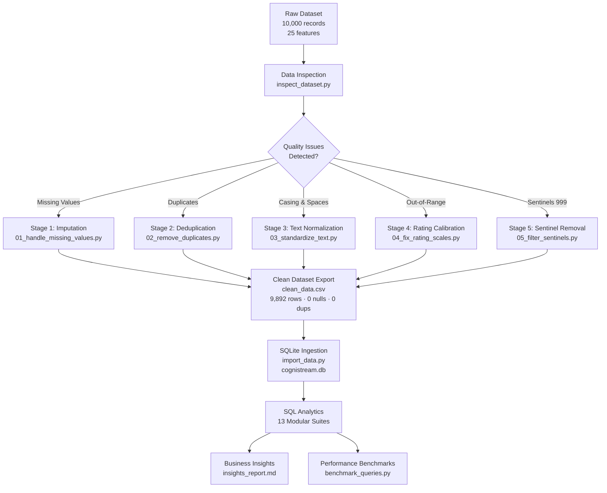

# Cognistream-Data-Analytics
Cognistream :Developer Flow State and Cognitive Load Analytics
# Cognistream: Developer Flow State and Cognitive Load Analytics

## 1. Project Overview

Cognistream is a data analytics project focused on understanding developers' flow state and cognitive load through data analysis and visualization. The project uses a structured dataset containing developer-related measurements to identify patterns, distributions, relationships, and trends that may help explain developers' work experiences and concentration levels.

The project applies Python-based data analysis, statistical methods, and data visualization to convert raw data into meaningful insights. The findings can help stakeholders better understand developer productivity patterns and potential cognitive workload factors.

## 2. Project Statement

Developers may experience different levels of concentration, engagement, and cognitive workload while performing technical tasks. Understanding these patterns through data can help identify factors associated with flow state and cognitive load.

The objective of this project is to analyze developer flow state and cognitive load data, examine relevant variables, identify meaningful patterns, and present the findings through clear visualizations and documentation.

## 3. Project Objectives

- Understand the structure and characteristics of the developer dataset.
- Examine data quality, including missing values, duplicate records, and data types.
- Calculate descriptive statistics to summarize important variables.
- Analyze developer flow state and cognitive load using relevant dataset columns.
- Explore relationships and trends supported by the available data.
- Create charts to communicate analytical findings.
- Document the methods, findings, recommendations, and limitations.

## 4. Project Goals

- Transform the raw dataset into useful analytical information.
- Identify patterns in developer flow state and cognitive load.
- Support observations with numerical evidence and appropriate charts.
- Improve the interpretability of developer-related data.
- Maintain clear project documentation and version-control history through GitHub.

## 5. Dataset Overview

**Dataset file:** `Cognistream _Developer _Flow_state_Cognitive_Load_10000.xlsx`

**Format:** Excel workbook (`.xlsx`)

**Purpose:** To analyze developer flow state and cognitive load using the available developer-related variables.

The dataset contains the source information for the analysis. The exact row count, column names, data types, and variable meanings should be documented using the actual dataset rather than assumed values.

## 6. Project Structure

```text
Cognistream/
│
├── data/
│   └── Cognistream _Developer _Flow_state_Cognitive_Load_10000.xlsx
│
├── Python Analysis/
│   ├── Data Structure.py
│   ├── Python Analysis.py
│   └── README.md
│
├── README.md
└── [Additional project files, if required]
```

### Folder and File Descriptions

- **data/** — Stores the source dataset used for analysis.
- **Data Structure.py** — Examines dataset dimensions, column names, data types, and structure.
- **Python Analysis.py** — Contains the Python code for statistical analysis, relevant flow-state and cognitive-load analysis, and supporting visualizations, as implemented.
- **Python Analysis/README.md** — Documents the Python analysis methods, charts, and results.
- **Main README.md** — Presents the overall project overview, problem statement, objectives, structure, workflow, team responsibilities, and progress status.

The structure above represents the planned organization; include only files and completed components that actually exist in the repository.

## 7. Tools and Technologies

- **Python** — Main programming language for data analysis.
- **Pandas** — Dataset loading, inspection, and data manipulation.
- **NumPy** — Numerical calculations and statistical operations where needed.
- **Matplotlib** — Creating charts and visualizations.
- **Excel** — Source dataset format and initial data inspection.
- **GitHub** — Source-code management, collaboration, documentation, and commit tracking.

## 8. Project Workflow

### Step 1: Dataset Collection
Locate and load the supplied Excel dataset.

### Step 2: Data Structure Inspection
Inspect the number of rows and columns, column names, data types, and general dataset structure.

### Step 3: Data Quality Assessment
Check for missing values, duplicate records, inconsistent data types, and other relevant quality issues. Document the actual results.

### Step 4: Descriptive Statistical Analysis
Calculate suitable statistics, such as mean, median, standard deviation, minimum, maximum, and frequency distributions, according to the variable types.

### Step 5: Developer Flow State Analysis
Analyze the relevant flow-state variables and compare their distributions or patterns across appropriate groups, where supported by the dataset.

### Step 6: Cognitive Load Analysis
Examine the available cognitive-load variables and identify meaningful distributions, patterns, or differences.

### Step 7: Relationship and Trend Analysis
Investigate relationships between relevant variables and identify patterns that can be supported by the data. Avoid claiming causation from correlation alone.

### Step 8: Data Visualization
Create appropriate charts to communicate the analytical results. Each chart should have a clear title, labeled axes, and an explanation supported by the actual output.

### Step 9: Findings and Recommendations
Summarize the important numerical findings, explain their potential significance, and provide recommendations within the limits of the dataset.

### Step 10: Documentation and GitHub Updates
Document the analysis methods, chart descriptions, findings, limitations, and conclusions. Maintain the project files and commit history in the appropriate repository branches.

## 9. Team Responsibilities

The following reflects the current team allocation discussed for the project.

- **Lavanesh:** Dataset collection, preparation, column understanding, and data quality.
- **Tahseen:** SQL queries, aggregations, and supporting analytical insights, including relevant Python/Pandas work.
- **Naved:** Power BI dashboard development and visualization.
- **Vasantha:** Python/Pandas dataset loading, descriptive analysis, distributions, relationships, patterns and trends, and analytical documentation.

Individual responsibilities and completion status should be updated as the project progresses.

## 10. Current Project Status

The project is in progress.

### Work completed or initiated
- Source dataset identified and organized in the project.
- Python analysis folder and supporting files created.
- Initial dataset loading and structure inspection work carried out.
- Missing-value and duplicate-record checks initiated.
- Developer flow-state chart analysis and its documentation started.
- GitHub commits used to track project work.

### Work remaining or requiring verification
- Complete descriptive statistics and relevant cognitive-load analysis.
- Analyze relationships and trends using actual dataset variables.
- Complete the required visualizations and validate their descriptions against the charts.
- Document numerical findings and evidence-based recommendations.
- Complete the conclusion, limitations, and analysis methodology.
- Review the README files and confirm that the repository matches the actual work completed.
- Coordinate and verify the team's SQL and Power BI contributions.

The items listed as remaining should be checked against the latest files before the final submission.

## 11. Expected Deliverables

- Organized source dataset.
- Python scripts for data inspection and analysis.
- Descriptive statistical results.
- Relevant flow-state and cognitive-load charts.
- Evidence-based findings and recommendations.
- Main project README and detailed Python analysis documentation.
- GitHub repository containing the project work and commit history.

## 12. Expected Outcome

The project aims to produce a clear, evidence-based understanding of patterns in developer flow state and cognitive load. Through statistical analysis and visualization, Cognistream will help communicate what the dataset reveals about developer-related experiences and identify areas that may warrant further investigation.

The conclusions will depend on the actual analytical results and the limitations of the available data.


## Data Structure Documentation

### 1. Objective
The objective of data structure analysis is to understand the organization and characteristics of the Cognistream dataset before performing further analysis.

### 2. Dataset Loading
The dataset is provided in Excel format and is loaded into Python using the Pandas library. The dataset is stored in a DataFrame, which allows rows and columns to be inspected and analyzed efficiently.

### 3. Dataset Dimensions
The dataset dimensions indicate the total number of records and columns available for analysis. The number of rows and columns is checked using Python to understand the size of the dataset.

### 4. Column Names
The column names are inspected to identify the variables available for analysis. These variables help determine which attributes are relevant to developer flow state and cognitive load.

### 5. Data Types
The data types of the columns are examined to identify numerical, categorical, date/time, and other types of information. Understanding data types helps determine suitable statistical methods and visualizations.

### 6. Initial Observations
The initial inspection provides an overview of the dataset's structure and helps identify the variables required for subsequent data quality checks, descriptive statistics, developer flow-state analysis, and cognitive-load analysis.

### 7. Conclusion
Data structure inspection establishes the foundation for the Cognistream analytical workflow. Understanding the dataset dimensions, column names, and data types helps ensure that subsequent analyses use appropriate variables and methods.


## Data Quality Documentation

### 1. Objective
The objective of data quality assessment is to evaluate the completeness, consistency, and reliability of the Cognistream dataset before performing detailed data analysis.

### 2. Missing Values Check
The dataset is checked for missing or null values in each column. This helps identify incomplete records that may affect statistical calculations and visualizations.

### 3. Duplicate Records Check
The dataset is examined for duplicate rows to determine whether repeated records are present. Duplicate records are reviewed to understand whether they are genuine observations or unintended repetitions.

### 4. Data Type Verification
The data types of the dataset columns are inspected to verify that numerical, categorical, and date/time variables are represented appropriately for analysis.

### 5. Data Consistency Check
The dataset is reviewed for inconsistent values, unexpected categories, invalid numerical values, and formatting issues where applicable.

### 6. Data Quality Findings
The findings from missing-value checks, duplicate checks, data type verification, and consistency checks are documented based on the actual Python outputs.

- Missing values: To be confirmed from the analysis output.
- Duplicate records: To be confirmed from the analysis output.
- Data type issues: To be confirmed from the analysis output.
- Other inconsistencies: To be confirmed from the analysis output.

### 7. Conclusion
Data quality assessment helps identify potential issues that could affect the accuracy and reliability of the analysis. The results of these checks provide a basis for deciding whether data cleaning or additional validation is required before proceeding with descriptive statistics, flow-state analysis, and cognitive-load analysis.


## Descriptive Statistics Analysis

### 1. Objective
The objective of descriptive statistical analysis is to summarize the important characteristics of the Cognistream dataset and understand the distribution and variability of relevant variables.

### 2. Analysis Method
Python, Pandas, and NumPy are used where appropriate to calculate descriptive statistics for numerical variables. The analysis may include:
- **Mean:** The average value of a variable.
- **Median:** The middle value of a variable.
- **Standard Deviation:** A measure of variation in the data.
- **Minimum and Maximum:** The smallest and largest observed values.
- **Count:** The number of valid observations.
- **Frequency Distribution:** The number of occurrences in categorical variables, where relevant.

### 3. Analysis Process
The relevant numerical columns are identified, and descriptive statistics are calculated using Python. The outputs are examined to understand typical values, variation, and potential unusual observations.

### 4. Findings
The statistical results are reviewed to identify meaningful characteristics of the dataset. Numerical findings are documented using the actual Python outputs rather than assumptions.

### 5. Conclusion
Descriptive statistics provide a foundation for understanding the dataset and selecting appropriate methods for further analysis of developer flow state and cognitive load.


## Developer Flow State Chart Analysis

### 1. Objective
The objective of this analysis is to visualize the average values of numerical columns in the Cognistream developer flow state and cognitive load dataset. The chart provides an overview of the average values across the numerical metrics available in the dataset.

### 2. Tools and Libraries Used
- **Pandas:** Loads the Excel dataset, identifies numerical columns, and calculates their average values.
- **Matplotlib:** Creates and displays the bar chart.
- **Google Colab:** Provides the environment for uploading and analyzing the dataset.

### 3. Analysis Methodology
The Excel dataset is uploaded and loaded into a Pandas DataFrame. The dataset's dimensions and column names are displayed to understand its structure.

Next, the numerical columns are selected using Pandas' `select_dtypes()` method. The mean of each numerical column is calculated and plotted as a bar chart.

The chart is configured with a title, axis labels, and rotated x-axis labels to improve readability. The resulting visualization is saved as `developer_flow_state_chart.png` and displayed for inspection.

### 4. Chart Description
The bar chart titled **Developer Flow State Chart Analysis** displays the average values of the numerical columns in the dataset.

- **X-axis:** Names of the numerical metrics.
- **Y-axis:** Average value of each numerical metric.
- **Bars:** Each bar represents the mean of one numerical column.

The chart provides a visual comparison of the calculated averages across the selected numerical variables.

### 5. Findings and Interpretation
The chart can be used to identify which numerical variables have higher or lower average values within their respective measurement scales. Actual observations should be recorded after reviewing the generated chart and the calculated mean values.

Because the numerical columns may represent different measurements or scales, the bar heights should not automatically be interpreted as a direct comparison of importance or performance.

### 6. Output
The analysis generates the following output:

- Dataset dimensions and column names printed in the output.
- A bar chart showing the mean of each numerical column.
- A saved visualization named `developer_flow_state_chart.png`.

### 7. Conclusion
This analysis provides an initial visual summary of the numerical variables in the Cognistream dataset. It helps identify the average values of the available metrics and provides a starting point for more focused developer flow state and cognitive load analysis.

### 8. Limitation
The chart displays the averages of all numerical columns rather than isolating flow-state variables specifically. Therefore, it should be treated as an overall numerical-metrics chart, not as a dedicated flow-state score chart. Further analysis should select the relevant flow-state and cognitive-load variables and interpret them according to their definitions and measurement scales.


# Cognitive Load Distribution Among Developers

## 1. Objective

The objective of this analysis is to understand the distribution of cognitive load values in the Cognistream developer dataset. It helps examine how cognitive load varies across the recorded observations and identify the overall pattern of mental workload.

## 2. Tools and Libraries Used

- **Python:** Used to perform the analysis.
- **Pandas:** Used to load the Excel dataset, clean column names, and process cognitive load values.
- **Matplotlib:** Used to create the cognitive load distribution histogram.
- **Google Colab:** Used to execute the Python code and display the results.

## 3. Methodology

The analysis was performed through the following steps:

1. **Dataset Upload:** Uploaded the Excel dataset into Google Colab.
2. **Data Loading:** Loaded the Excel file into a Pandas DataFrame.
3. **Column Name Cleaning:** Removed leading and trailing spaces from column names.
4. **Dataset Inspection:** Displayed the dataset dimensions and column names.
5. **Cognitive Load Identification:** Automatically searched for a column containing both the words "cognitive" and "load".
6. **Data Conversion:** Converted cognitive load values into numeric format. Invalid or missing values were excluded from the analysis.
7. **Distribution Visualization:** Created a histogram using 20 bins to show the frequency distribution of cognitive load values.
8. **Statistical Analysis:** Calculated the number of valid records, mean, median, standard deviation, minimum, and maximum.

## 4. Cognitive Load Distribution Analysis

A histogram was generated to visualize the distribution of cognitive load values in the dataset.

- **X-axis:** Cognitive Load values.
- **Y-axis:** Frequency, representing the number of observations within each interval.
- **Number of bins:** 20.

The histogram helps identify where cognitive load values are concentrated and whether the observations are spread across a narrow or wide range.

**Note:** This code analyzes the overall distribution of cognitive load values. It does not group the data by individual developers.

## 5. Descriptive Statistics

The following statistical measures were calculated:

| Statistical Measure | Purpose |
|---|---|
| Valid Records | Number of numeric cognitive load values included in the analysis |
| Mean | Average cognitive load value |
| Median | Middle value of the cognitive load observations |
| Standard Deviation | Measures the variability of cognitive load values |
| Minimum | Lowest recorded cognitive load value |
| Maximum | Highest recorded cognitive load value |

These measures provide a numerical summary of the dataset and help explain the central tendency and variability of cognitive load.


## Key Findings

- The cognitive load histogram provides an overview of the distribution and frequency of recorded cognitive load values.
- The mean identifies the average cognitive load across valid observations.
- The median indicates the middle cognitive load value and helps understand the central tendency of the data.
- The standard deviation measures the variability of cognitive load values.
- The minimum and maximum values identify the lowest and highest recorded cognitive load values.
- Comparing the mean and median, along with the histogram, can help reveal the distribution pattern of cognitive load observations.

**Note:** The actual mean, median, standard deviation, minimum, maximum, and valid record count should be included after running the Python code. These numerical results are needed to support specific findings.

## 7. Conclusion

The cognitive load distribution analysis provides an overview of the mental workload values recorded in the Cognistream dataset. The histogram presents the frequency distribution, while descriptive statistics summarize the average, central value, variability, and range of the observations.

This analysis establishes a foundation for further investigation into developer cognitive load and flow state.

## 1. Visualize Developer Activity

### Objective
To visualize developer activity and understand working patterns using Python data visualization techniques.

### Tools Used
- Python
- Pandas
- Matplotlib
- Excel dataset

### Activities Performed
- Loaded the Cognistream dataset using Pandas.
- Identified important developer activity metrics.
- Visualized developer activity using charts.
- Compared coding hours, commit count, and task completion rate.
- Observed activity patterns across the available data.

### Outcome
Created visual representations of developer activity to make comparisons easier and understand developer working patterns.

## 2. Relevant Metrics Analysis

### Objective
To identify and analyse important metrics related to developer flow state, cognitive load, and productivity.

### Metrics Analysed
- Coding Hours
- Commit Count
- Task Completion Rate
- Cognitive Load
- Flow State

### Activities Performed
- Selected relevant metrics from the dataset.
- Checked the availability of required columns.
- Compared developer activity with cognitive load and flow state.
- Examined relationships between productivity metrics.
- Used Python and Pandas for metric analysis.

### Outcome
Identified important metrics for understanding developer activity, flow state, and cognitive load. This analysis provides a foundation for identifying patterns and drawing meaningful insights from the dataset.
## 8. Limitations

- The analysis covers only valid numeric cognitive load values.
- Missing and invalid values are excluded after numeric conversion.
- The histogram shows the overall distribution rather than developer-specific comparisons.
- Cognitive load alone does not explain developer productivity or performance.

## Pattern and Trend Analysis

### Objective
To identify patterns and relationships in developer flow states, cognitive load, task duration, and interruptions.

### Activities Performed
- Standardized flow-state categories by removing extra spaces and inconsistent capitalization.
- Identified the frequency of different developer flow states.
- Analysed cognitive load score distribution.
- Compared average task duration across different flow states.
- Examined interruption patterns across developer flow states.

### Key Observations
- Focused was the most frequently observed flow state in the initial analysis.
- Interrupted was the second most frequently observed flow state.
- Average cognitive load score was approximately 5.75.
- Multitasking showed a higher average task duration in the initial output.
- Different flow states showed variations in average interruption counts.

### pattern and trends :
### Key Observations – Pattern Analysis

1. **Developer Flow State:** Focused was the most frequently observed flow state, with 2,943 sessions, followed by Interrupted with 2,007 sessions.

2. **Cognitive Load:** The average cognitive load score was approximately 5.75, with a median of 5.80 across 9,748 records.

3. **Task Duration:** Multitasking recorded the highest average task duration at approximately 225.33 minutes among the main flow-state categories.

4. **Interruptions:** Focused sessions recorded an average of 3 interruptions, while Interrupted sessions recorded an average of 2.6 interruptions in the initial output.

5. **Data Quality:** Flow-state categories contained inconsistent capitalization and extra spaces, which required standardization for accurate analysis.

6. **Cognitive Load Validation:** Cognitive load scores ranged from -2 to 15, indicating that the minimum and maximum values should be checked against the expected score range.
   
### Outcome
Identified important patterns in developer activity, flow state, and cognitive load. The analysis provides a foundation for further trend visualization and insight generation.

### Tools Used
- Python
- Pandas
- Excel Dataset

  ## Pattern and Trend Visualization

### Objective
To visually represent developer flow state, cognitive load, task duration, and interruption patterns to understand developer working behaviour.

### Tools Used
- Python
- Pandas
- Matplotlib
- Excel Dataset


### Charts Created

1. **Task Duration by Flow State** – Compared average task duration across different flow states.

2. **Interruptions by Flow State** – Analysed average interruptions across different flow states.

3. **Cognitive Load Trend Over Time** – Visualized changes in average cognitive load across session dates.

4. **Flow Efficiency by Flow State** – Compared average flow efficiency across different flow states.
   
### Visualization Techniques
- Bar Chart
- Histogram
- Trend Line Chart

### Outcome
Created visual representations of important developer activity metrics and behavioural patterns. The charts help identify differences across flow states and examine cognitive load changes over time.

## Key Findings and Insights

### Objective
To summarize the important findings obtained from developer flow state, cognitive load, task duration, interruptions, and activity analysis.

### Key Findings
- Identified the most frequently observed developer flow states.
- Analysed cognitive load distribution among developer sessions.
- Compared task duration across different flow states.
- Examined interruption patterns during developer sessions.
- Identified changes in cognitive load over time.

### Insights
- Developer flow states vary across working sessions.
- Cognitive load scores provide information about developers' mental effort.
- Task duration and interruption patterns differ across flow states.
- Time-based analysis helps identify changes in cognitive load.

### Outcome
The findings provide an overall understanding of developer working patterns, flow states, and cognitive load, supporting further analysis of developer productivity.
# CogniStream: Developer Flow State & Cognitive Load Analytics


---

## Overview

This repository contains the end-to-end **data cleaning pipeline, relational database architecture, and modular SQL analytics suite** for the CogniStream project — analyzing developer workflow telemetry to understand cognitive load, flow efficiency, and productivity patterns across engineering teams.

**Contributor:** Tahseen Parvej — Data Analyst & SQL Database Engineer  
**Dataset:** `CogniStream_Developer_Flow_State_Cognitive_Load_10000.xlsx`  
**Clean Records:** 9,892 sessions · 802 developers · 30 projects · 365 days  
**Database:** SQLite 3 (`cognistream.db`) — 6 B-Tree performance indexes  

---

## Project Pipeline



---

## Key Metrics

| Metric | Value |
| :--- | :---: |
| Total Developer Hours Logged | **19,833.4 hrs** |
| Avg Session Duration | **120.3 mins** |
| Avg Cognitive Load | **5.75 / 10.0** |
| Avg Flow Efficiency | **71.57%** |
| Sessions at High Cognitive Risk (≥ 7.0) | **28.27%** |
| Total Idle Time Lost | **6,583.5 hrs (33.19%)** |
| Developers at Burnout Risk (Tier 3) | **33 developers** |
| Query Speedup via B-Tree Indexing | **up to 34x faster** |

---

## Repository Structure

```
Cognistream-Data-Analytics/
│
├── data/
│   ├── raw/
│   │   └── CogniStream_Developer_Flow_State_Cognitive_Load_10000.xlsx
│   └── cleaned/
│       ├── clean_data.csv              # 9,892 clean records
│       └── clean_data.xlsx
│
├── data_cleaning/
│   ├── 01_handle_missing_values.py     # Stage 1: Imputation
│   ├── 02_remove_duplicates.py         # Stage 2: Deduplication
│   ├── 03_standardize_text.py          # Stage 3: Text normalization
│   ├── 04_fix_rating_scales.py         # Stage 4: Rating calibration
│   ├── 05_filter_sentinels.py          # Stage 5: Sentinel removal
│   ├── clean_data.py                   # Final pipeline orchestrator
│   └── data_cleaning_report.md
│
├── sql/
│   ├── 01_schema.sql                   # DDL, constraints & views
│   ├── 02_data_overview.sql            # Dataset baseline queries
│   ├── 03_data_quality_audit.sql       # 0-null & 0-duplicate verification
│   ├── 04_executive_kpis.sql           # KPI summary & deep work rate
│   ├── 05_role_and_task_distribution.sql
│   ├── 06_application_productivity.sql
│   ├── 07_interruption_analysis.sql
│   ├── 08_urgency_and_outcomes.sql
│   ├── 09_temporal_trend_analysis.sql
│   ├── 10_flow_efficiency_ctes.sql     # 4-tier developer segmentation
│   ├── 11_window_functions_ranking.sql # DENSE_RANK, LAG, NTILE, PERCENT_RANK
│   ├── 12_cross_metric_correlations.sql# Pearson r correlation matrix
│   └── 13_query_optimization.sql       # B-Tree indexes & EXPLAIN QUERY PLAN
│
├── scripts/
│   ├── inspect_dataset.py              # Quality audit on raw data
│   ├── import_data.py                  # Automated SQLite ingestion
│   └── benchmark_queries.py            # Indexed vs unindexed timing suite
│
├── benchmarks/
│   └── query_benchmark_results.md      # Latency comparison report
│
├── insights/
│   └── insights_report.md              # Executive findings & recommendations
│
├── cognistream.db                      # SQLite database (9,892 records, 6 indexes)
├── CONTRIBUTING.md
└── README.md
```

---

## SQL Analytical Suites

<details>
<summary><strong>Suite 01–03: Database Setup, Overview & Quality Audit</strong></summary>

```sql
-- Zero-null verification (sql/03_data_quality_audit.sql)
SELECT 
    SUM(CASE WHEN Developer_ID IS NULL THEN 1 ELSE 0 END) AS Null_Developer_IDs,
    SUM(CASE WHEN Cognitive_Load_Score IS NULL THEN 1 ELSE 0 END) AS Null_Load_Scores,
    SUM(CASE WHEN Flow_Efficiency_Score IS NULL THEN 1 ELSE 0 END) AS Null_Flow_Scores
FROM cognistream_sessions;
-- Result: 0 | 0 | 0 ✅
```
</details>

<details>
<summary><strong>Suite 04–05: Executive KPIs & Role Distribution</strong></summary>

```sql
-- Deep work rate & idle friction (sql/04_executive_kpis.sql)
SELECT 
    COUNT(*) AS Total_Sessions,
    ROUND(SUM(Task_Duration_Minutes) / 60.0, 1) AS Total_Hours,
    ROUND(AVG(Cognitive_Load_Score), 2) AS Avg_Cognitive_Load,
    ROUND(AVG(Flow_Efficiency_Score), 2) AS Avg_Flow_Efficiency,
    ROUND(SUM(Idle_Time_Minutes) * 100.0 / SUM(Task_Duration_Minutes), 2) AS Idle_Friction_Ratio_Pct
FROM cognistream_sessions;
-- Result: 9892 | 19833.4 hrs | 5.75 | 71.57% | 33.19%
```
</details>

<details>
<summary><strong>Suite 10: Developer Segmentation CTEs (4-Tier Model)</strong></summary>

```sql
-- 4-tier burnout segmentation (sql/10_flow_efficiency_ctes.sql)
WITH DeveloperAggregates AS (
    SELECT Developer_ID, Role,
        ROUND(AVG(Cognitive_Load_Score), 2) AS Avg_CL,
        ROUND(AVG(Flow_Efficiency_Score), 2) AS Avg_FE
    FROM cognistream_sessions GROUP BY Developer_ID, Role
)
SELECT 
    CASE 
        WHEN Avg_FE >= 75.0 AND Avg_CL <= 5.5 THEN 'Tier 1: High Flow & Low Strain'
        WHEN Avg_FE >= 70.0 AND Avg_CL <= 6.5 THEN 'Tier 2: Steady Sustainable'
        WHEN Avg_CL >= 6.5 AND Avg_FE < 70.0 THEN 'Tier 3: High Cognitive Burnout Risk'
        ELSE 'Tier 4: Fragmented / Low Efficiency'
    END AS Segment,
    COUNT(*) AS Developer_Count
FROM DeveloperAggregates GROUP BY 1;
-- Result: Tier 1: 57 | Tier 2: 385 | Tier 3: 33 | Tier 4: 327
```
</details>

<details>
<summary><strong>Suite 11: Window Functions & Longitudinal Rankings</strong></summary>

```sql
-- 5-session rolling cognitive load average (sql/11_window_functions_ranking.sql)
SELECT 
    Record_ID, Developer_ID, Session_Date, Cognitive_Load_Score,
    ROUND(AVG(Cognitive_Load_Score) OVER (
        PARTITION BY Developer_ID 
        ORDER BY Session_Date, Record_ID 
        ROWS BETWEEN 4 PRECEDING AND CURRENT ROW
    ), 2) AS Rolling_5Sess_Avg_Cognitive_Load
FROM cognistream_sessions
ORDER BY Developer_ID, Session_Date;
```
</details>

<details>
<summary><strong>Suite 12: Pearson Correlation Matrix</strong></summary>

```sql
-- Direct SQLite Pearson r computation (sql/12_cross_metric_correlations.sql)
WITH CorrelationMath AS (
    SELECT 
        ROUND((COUNT(*) * SUM(Idle_Time_Minutes * Task_Duration_Minutes) 
               - SUM(Idle_Time_Minutes) * SUM(Task_Duration_Minutes)) /
              (SQRT(COUNT(*) * SUM(Idle_Time_Minutes * Idle_Time_Minutes) 
                    - SUM(Idle_Time_Minutes) * SUM(Idle_Time_Minutes)) *
               SQRT(COUNT(*) * SUM(Task_Duration_Minutes * Task_Duration_Minutes) 
                    - SUM(Task_Duration_Minutes) * SUM(Task_Duration_Minutes))), 4
        ) AS R_Idle_vs_Duration
    FROM cognistream_sessions
)
SELECT * FROM CorrelationMath;
-- Result: r = +0.2914 (moderate positive: longer sessions → more idle drift)
```
</details>

<details>
<summary><strong>Suite 13: Query Optimization & Benchmarks</strong></summary>

```sql
-- B-Tree index on developer ID (sql/13_query_optimization.sql)
CREATE INDEX IF NOT EXISTS idx_sessions_developer_id 
ON cognistream_sessions (Developer_ID);

-- Query plan verification
EXPLAIN QUERY PLAN
SELECT * FROM cognistream_sessions WHERE Developer_ID = 'DEV-0100';
-- SEARCH cognistream_sessions USING INDEX idx_sessions_developer_id ✅ (34x speedup)
```
</details>

---

## Quick Start

```bash
# Clone the repository
git clone -b Tahseen_Parvej https://github.com/svasantha633/Cognistream-Data-Analytics.git
cd Cognistream-Data-Analytics

# Install dependencies
pip install pandas openpyxl

# Run the full data cleaning pipeline
python data_cleaning/clean_data.py

# Import cleaned data into SQLite
python scripts/import_data.py

# Run query benchmarks
python scripts/benchmark_queries.py

# Open SQLite and run any analytical suite
sqlite3 cognistream.db < sql/04_executive_kpis.sql
```

---

## Core Findings

1. **33.19% idle friction ratio** — 6,583.5 of 19,833.4 total developer hours are classified as idle time. Longer sessions accumulate disproportionately more idle drift (r = +0.29).
2. **28.27% of sessions** at high cognitive load risk (≥ 7.0 / 10.0). Content Writers carry the highest average strain at 5.83/10.0.
3. **Only 17.9% of sessions** recorded in verified `Flow` state; 50.3% of all sessions end `Blocked` or `Abandoned`.
4. **33 developers (4.1%)** classified as Tier 3 Burnout Risk — high cognitive load combined with below-70% flow efficiency.
5. **B-Tree indexing** reduced developer lookup latency from 3.48 ms to 0.10 ms — a **34x speedup**.

---

## Dependencies

| Package | Version | Purpose |
| :--- | :--- | :--- |
| Python | 3.11+ | Pipeline & benchmarking |
| pandas | 2.x | Data cleaning & transformation |
| openpyxl | 3.x | Excel file I/O |
| sqlite3 | Built-in | Relational database engine |

---

*Part of the CogniStream Data Analytics project — Branch `Tahseen_Parvej`*
