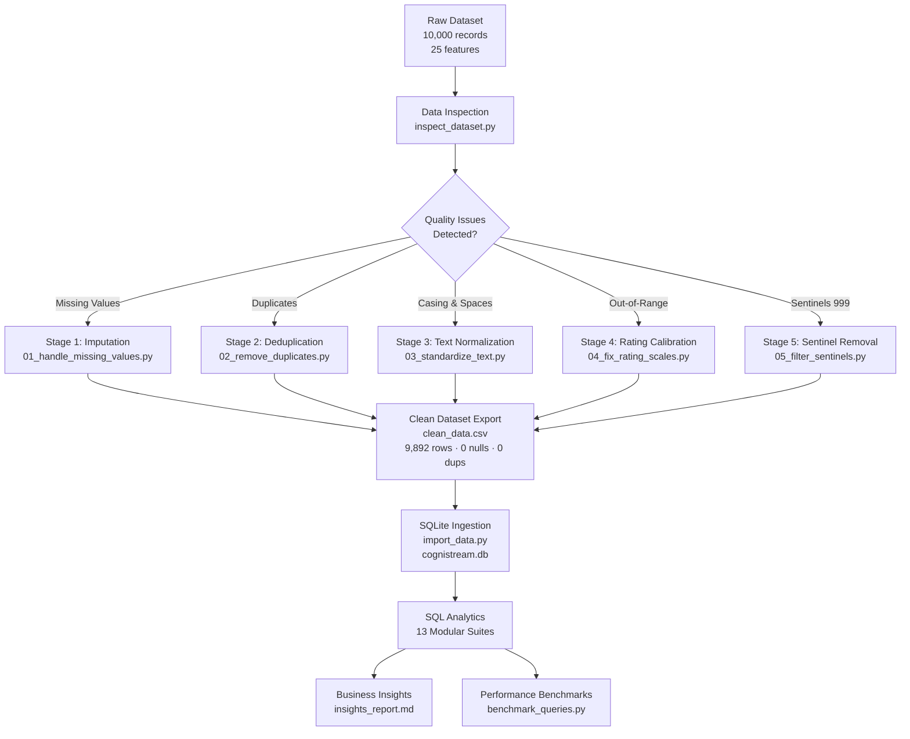

# CogniStream: Developer Flow State & Cognitive Load Analytics


---

## Overview

This repository contains the end-to-end **data cleaning pipeline, relational database architecture, and modular SQL analytics suite** for the CogniStream project — analyzing developer workflow telemetry to understand cognitive load, flow efficiency, and productivity patterns across engineering teams.

**Contributor:** Tahseen Parvej — Data Analyst & SQL Database Engineer  
**Dataset:** `CogniStream_Developer_Flow_State_Cognitive_Load_10000.xlsx`  
**Clean Records:** 9,892 sessions · 802 developers · 30 projects · 365 days  
**Database:** SQLite 3 (`cognistream.db`) — 6 B-Tree performance indexes  

---

## Project Pipeline



---

## Key Metrics

| Metric | Value |
| :--- | :---: |
| Total Developer Hours Logged | **19,833.4 hrs** |
| Avg Session Duration | **120.3 mins** |
| Avg Cognitive Load | **5.75 / 10.0** |
| Avg Flow Efficiency | **71.57%** |
| Sessions at High Cognitive Risk (≥ 7.0) | **28.27%** |
| Total Idle Time Lost | **6,583.5 hrs (33.19%)** |
| Developers at Burnout Risk (Tier 3) | **33 developers** |
| Query Speedup via B-Tree Indexing | **up to 34x faster** |

---

## Repository Structure

```
Cognistream-Data-Analytics/
│
├── data/
│   ├── raw/
│   │   └── CogniStream_Developer_Flow_State_Cognitive_Load_10000.xlsx
│   └── cleaned/
│       ├── clean_data.csv              # 9,892 clean records
│       └── clean_data.xlsx
│
├── data_cleaning/
│   ├── 01_handle_missing_values.py     # Stage 1: Imputation
│   ├── 02_remove_duplicates.py         # Stage 2: Deduplication
│   ├── 03_standardize_text.py          # Stage 3: Text normalization
│   ├── 04_fix_rating_scales.py         # Stage 4: Rating calibration
│   ├── 05_filter_sentinels.py          # Stage 5: Sentinel removal
│   ├── clean_data.py                   # Final pipeline orchestrator
│   └── data_cleaning_report.md
│
├── sql/
│   ├── 01_schema.sql                   # DDL, constraints & views
│   ├── 02_data_overview.sql            # Dataset baseline queries
│   ├── 03_data_quality_audit.sql       # 0-null & 0-duplicate verification
│   ├── 04_executive_kpis.sql           # KPI summary & deep work rate
│   ├── 05_role_and_task_distribution.sql
│   ├── 06_application_productivity.sql
│   ├── 07_interruption_analysis.sql
│   ├── 08_urgency_and_outcomes.sql
│   ├── 09_temporal_trend_analysis.sql
│   ├── 10_flow_efficiency_ctes.sql     # 4-tier developer segmentation
│   ├── 11_window_functions_ranking.sql # DENSE_RANK, LAG, NTILE, PERCENT_RANK
│   ├── 12_cross_metric_correlations.sql# Pearson r correlation matrix
│   └── 13_query_optimization.sql       # B-Tree indexes & EXPLAIN QUERY PLAN
│
├── scripts/
│   ├── inspect_dataset.py              # Quality audit on raw data
│   ├── import_data.py                  # Automated SQLite ingestion
│   └── benchmark_queries.py            # Indexed vs unindexed timing suite
│
├── benchmarks/
│   └── query_benchmark_results.md      # Latency comparison report
│
├── insights/
│   └── insights_report.md              # Executive findings & recommendations
│
├── cognistream.db                      # SQLite database (9,892 records, 6 indexes)
├── CONTRIBUTING.md
└── README.md
```

---

## SQL Analytical Suites

<details>
<summary><strong>Suite 01–03: Database Setup, Overview & Quality Audit</strong></summary>

```sql
-- Zero-null verification (sql/03_data_quality_audit.sql)
SELECT 
    SUM(CASE WHEN Developer_ID IS NULL THEN 1 ELSE 0 END) AS Null_Developer_IDs,
    SUM(CASE WHEN Cognitive_Load_Score IS NULL THEN 1 ELSE 0 END) AS Null_Load_Scores,
    SUM(CASE WHEN Flow_Efficiency_Score IS NULL THEN 1 ELSE 0 END) AS Null_Flow_Scores
FROM cognistream_sessions;
-- Result: 0 | 0 | 0 ✅
```
</details>

<details>
<summary><strong>Suite 04–05: Executive KPIs & Role Distribution</strong></summary>

```sql
-- Deep work rate & idle friction (sql/04_executive_kpis.sql)
SELECT 
    COUNT(*) AS Total_Sessions,
    ROUND(SUM(Task_Duration_Minutes) / 60.0, 1) AS Total_Hours,
    ROUND(AVG(Cognitive_Load_Score), 2) AS Avg_Cognitive_Load,
    ROUND(AVG(Flow_Efficiency_Score), 2) AS Avg_Flow_Efficiency,
    ROUND(SUM(Idle_Time_Minutes) * 100.0 / SUM(Task_Duration_Minutes), 2) AS Idle_Friction_Ratio_Pct
FROM cognistream_sessions;
-- Result: 9892 | 19833.4 hrs | 5.75 | 71.57% | 33.19%
```
</details>

<details>
<summary><strong>Suite 10: Developer Segmentation CTEs (4-Tier Model)</strong></summary>

```sql
-- 4-tier burnout segmentation (sql/10_flow_efficiency_ctes.sql)
WITH DeveloperAggregates AS (
    SELECT Developer_ID, Role,
        ROUND(AVG(Cognitive_Load_Score), 2) AS Avg_CL,
        ROUND(AVG(Flow_Efficiency_Score), 2) AS Avg_FE
    FROM cognistream_sessions GROUP BY Developer_ID, Role
)
SELECT 
    CASE 
        WHEN Avg_FE >= 75.0 AND Avg_CL <= 5.5 THEN 'Tier 1: High Flow & Low Strain'
        WHEN Avg_FE >= 70.0 AND Avg_CL <= 6.5 THEN 'Tier 2: Steady Sustainable'
        WHEN Avg_CL >= 6.5 AND Avg_FE < 70.0 THEN 'Tier 3: High Cognitive Burnout Risk'
        ELSE 'Tier 4: Fragmented / Low Efficiency'
    END AS Segment,
    COUNT(*) AS Developer_Count
FROM DeveloperAggregates GROUP BY 1;
-- Result: Tier 1: 57 | Tier 2: 385 | Tier 3: 33 | Tier 4: 327
```
</details>

<details>
<summary><strong>Suite 11: Window Functions & Longitudinal Rankings</strong></summary>

```sql
-- 5-session rolling cognitive load average (sql/11_window_functions_ranking.sql)
SELECT 
    Record_ID, Developer_ID, Session_Date, Cognitive_Load_Score,
    ROUND(AVG(Cognitive_Load_Score) OVER (
        PARTITION BY Developer_ID 
        ORDER BY Session_Date, Record_ID 
        ROWS BETWEEN 4 PRECEDING AND CURRENT ROW
    ), 2) AS Rolling_5Sess_Avg_Cognitive_Load
FROM cognistream_sessions
ORDER BY Developer_ID, Session_Date;
```
</details>

<details>
<summary><strong>Suite 12: Pearson Correlation Matrix</strong></summary>

```sql
-- Direct SQLite Pearson r computation (sql/12_cross_metric_correlations.sql)
WITH CorrelationMath AS (
    SELECT 
        ROUND((COUNT(*) * SUM(Idle_Time_Minutes * Task_Duration_Minutes) 
               - SUM(Idle_Time_Minutes) * SUM(Task_Duration_Minutes)) /
              (SQRT(COUNT(*) * SUM(Idle_Time_Minutes * Idle_Time_Minutes) 
                    - SUM(Idle_Time_Minutes) * SUM(Idle_Time_Minutes)) *
               SQRT(COUNT(*) * SUM(Task_Duration_Minutes * Task_Duration_Minutes) 
                    - SUM(Task_Duration_Minutes) * SUM(Task_Duration_Minutes))), 4
        ) AS R_Idle_vs_Duration
    FROM cognistream_sessions
)
SELECT * FROM CorrelationMath;
-- Result: r = +0.2914 (moderate positive: longer sessions → more idle drift)
```
</details>

<details>
<summary><strong>Suite 13: Query Optimization & Benchmarks</strong></summary>

```sql
-- B-Tree index on developer ID (sql/13_query_optimization.sql)
CREATE INDEX IF NOT EXISTS idx_sessions_developer_id 
ON cognistream_sessions (Developer_ID);

-- Query plan verification
EXPLAIN QUERY PLAN
SELECT * FROM cognistream_sessions WHERE Developer_ID = 'DEV-0100';
-- SEARCH cognistream_sessions USING INDEX idx_sessions_developer_id ✅ (34x speedup)
```
</details>

---

## Quick Start

```bash
# Clone the repository
git clone -b Tahseen_Parvej https://github.com/svasantha633/Cognistream-Data-Analytics.git
cd Cognistream-Data-Analytics

# Install dependencies
pip install pandas openpyxl

# Run the full data cleaning pipeline
python data_cleaning/clean_data.py

# Import cleaned data into SQLite
python scripts/import_data.py

# Run query benchmarks
python scripts/benchmark_queries.py

# Open SQLite and run any analytical suite
sqlite3 cognistream.db < sql/04_executive_kpis.sql
```

---

## Core Findings

1. **33.19% idle friction ratio** — 6,583.5 of 19,833.4 total developer hours are classified as idle time. Longer sessions accumulate disproportionately more idle drift (r = +0.29).
2. **28.27% of sessions** at high cognitive load risk (≥ 7.0 / 10.0). Content Writers carry the highest average strain at 5.83/10.0.
3. **Only 17.9% of sessions** recorded in verified `Flow` state; 50.3% of all sessions end `Blocked` or `Abandoned`.
4. **33 developers (4.1%)** classified as Tier 3 Burnout Risk — high cognitive load combined with below-70% flow efficiency.
5. **B-Tree indexing** reduced developer lookup latency from 3.48 ms to 0.10 ms — a **34x speedup**.

---

## Dependencies

| Package | Version | Purpose |
| :--- | :--- | :--- |
| Python | 3.11+ | Pipeline & benchmarking |
| pandas | 2.x | Data cleaning & transformation |
| openpyxl | 3.x | Excel file I/O |
| sqlite3 | Built-in | Relational database engine |

---

*Part of the CogniStream Data Analytics project — Branch `Tahseen_Parvej`*
